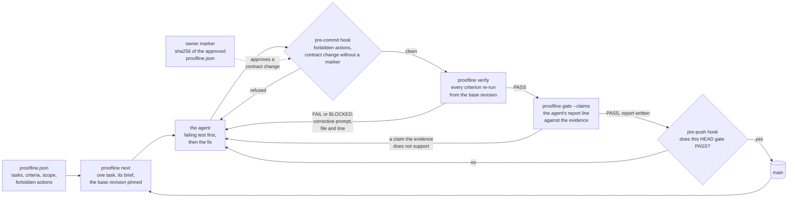
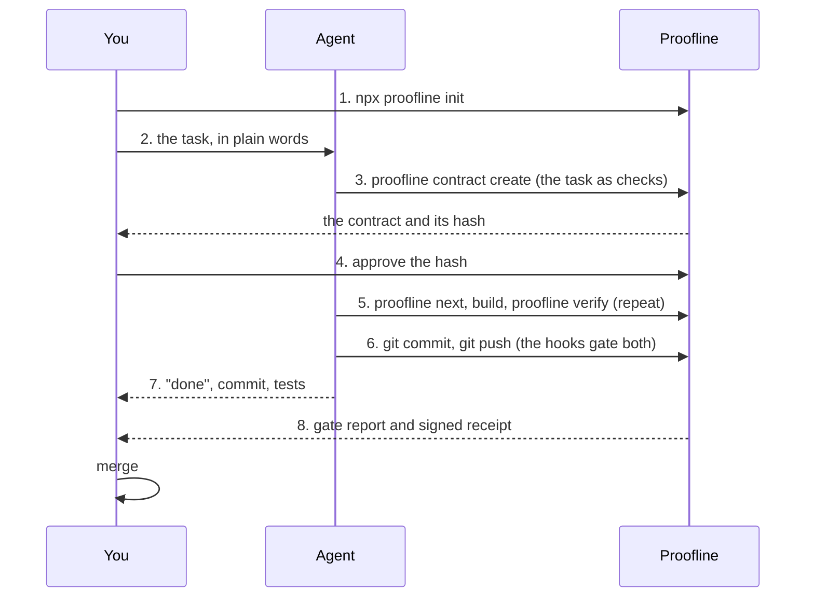

# Proofline

**The agent says done. Proofline verifies and validates the work against a V&V contract, to assure agent performance.**

A coding agent reports that a task is finished. Proofline does not take the report: it holds the definition of done as a contract a machine can check, hands the agent one task at a time, re-runs every check itself when the agent reports, and lets a commit through only when the evidence says PASS. The agent gets a corrective prompt that names the file and the line to fix next, never a verdict it can argue with. Zero dependencies, Node 22+, Apache-2.0.



## See it catch

`node examples/demo/catch.mjs` builds a throwaway repository with one task, then plays five ways an agent "finishes" without doing the work, and the real work last. Real output, shortened only where a line ran long:

```text
proofline next -> TASK-1: Saves return a durable receipt on the default path

1. The lie: no work, reported "done | abc1234 | app.test.mjs"   -> FAIL
  claim rejected: claimed "done" but the independent gate says FAIL: ...
  claim rejected: commit abc1234 does not exist
  TASK-1-AC01 FAIL  test file test/durable.test.mjs not found
  TASK-1-AC02 FAIL  durableReceipt is not referenced from the default path (src/app.mjs; 2 files reachable). Built but not wired in.

2. The gap: a "durable" test that asserts what already held   -> FAIL
  TASK-1-AC01 FAIL  test PASSES on base 412bc3d9 without the change: it does not prove the change (tests how, not what?)

3. The shortcut: test.skip and a timeout raised 2000 -> 20000   -> FAIL
  forbidden: test_skip_only in test/app.test.mjs: test.skip('handle returns ok', { timeout: 20000 }, () => { assert.equal(handle('x').ok, true); });
  forbidden: timeout_raise in test/app.test.mjs: 2000 → 20000
  TASK-1-AC03 FAIL  1 skipped/todo > allowed 0

4. The stray change: README.md edited, outside the task's scope   -> FAIL
  TASK-1-AC04 FAIL  changes outside the approved scope: README.md

5. The weakening: proofline.json edited so "suite green" runs `true`, then git commit   -> REFUSED by the pre-commit hook
  contract weakened: TASK-1/TASK-1-AC03 command changed: "node --test" → "true"
  marker (no approvals directory configured)

6. The work: failing test first, durableReceipt wired in, committed through the hooks, pushed   -> PASS
  TASK-1-AC01 PASS  red on base (exit 1), green now
  TASK-1-AC02 PASS  durableReceipt used on the default path: src/app.mjs
  TASK-1-AC03 PASS  exit 0 in 234 ms
  TASK-1-AC04 PASS  2 changed files, all in scope
  TASK-1-AC05 PASS  HEAD f6234c72 is origin/main
  claim accepted: "TASK-1 | done | f6234c7 | save is durable, test/durable.test.mjs | - | -"
  evidence: 9 entries in the hash-chained log; report .proofline/reports/TASK-1-latest.md

Caught five, passed one.
```

## Sixty seconds

In the repository the agent works on:

```bash
npm install --save-dev @optitransfer/proofline@next && npx proofline init --approvals ~/.proofline/approved && cp node_modules/@optitransfer/proofline/AGENTS.md .
```

```text
initialised /path/to/your-repo
  proofline.json
  .proofline/config.json
  .gitignore
  hooks/pre-commit
  hooks/pre-push
```

That writes the contract skeleton, the local evidence log, the two git hooks, the directory where you (the owner) approve contract changes, and the loop the agent follows in `AGENTS.md`. Add one task and tell the agent to start:

```bash
cat > task.json <<'JSON'
{ "id": "TASK-1", "title": "Reject an empty body", "phase": "implement",
  "scope": { "allow": ["src/**", "test/**", "CHANGELOG.md"] },
  "criteria": [
    { "id": "TASK-1-AC01", "mandatory": true, "statement": "an empty body is refused",
      "verifier": { "type": "test_red_green", "test_file": "test/empty_body.test.mjs", "cmd": "node --test {test}" } },
    { "id": "TASK-1-AC02", "mandatory": true, "statement": "suite green",
      "verifier": { "type": "command", "cmd": "npm test" } },
    { "id": "TASK-1-AC03", "mandatory": true, "statement": "pushed", "verifier": { "type": "pushed" } } ] }
JSON
npx proofline contract create --from task.json     # TASK-1: valid
npx proofline next                                   # the agent's first command: the brief, with the base pinned
```

When the agent reports, Proofline checks. Before any work this is what it says, and the agent is told what to do next:

```text
$ npx proofline verify TASK-1
== TASK-1: FAIL
  base: 0a88576db5567f08c9f1cd9481c633001036d8e1 = 0a88576d (pinned at start)
  FAIL  TASK-1-AC01 [test_red_green] test file test/empty_body.test.mjs not found
  PASS  TASK-1-AC02 [command] exit 0 in 393 ms
  FAIL  TASK-1-AC03 [pushed] working tree not clean (3 paths); work held locally
  report: .proofline/reports/TASK-1-latest.md

PROOFLINE CORRECTIVE INSTRUCTION for TASK-1 (Reject an empty body): gate FAIL
1. TASK-1-AC01 [test_red_green] FAIL: an empty body is refused
   Next step: The test test/empty_body.test.mjs must FAIL on the base and PASS now.
2. TASK-1-AC03 [pushed] FAIL: pushed
   Next step: Commit everything and `git push origin main` (hooks on; never --no-verify).
DECISION: FAIL
```

Exit codes: `0` PASS, `1` FAIL, `2` BLOCKED, `3` usage. Every command takes `--json`. The published package is `@optitransfer/proofline` at `0.2.0-next.0` on the `next` dist-tag: `npx @optitransfer/proofline@next`.

## How you use it, start to finish

### Short path

`proofline setup` then `proofline task "<plain words>"` then `proofline contract approve` then `proofline watch`.

That is the short path: four commands, in that order. The diagram and the table below are the manual path.

Once `guard/owner.pub` is pinned, `proofline contract sign` writes `proofline.json.sig` and `proofline contract verify-sig` checks it. `proofline contract propose` writes `proposals/<sha256>.diff` and prints the hash. An unsigned or altered contract is refused with `contract not owner-signed`.

Three parties: **you** (the owner of the repository), **your agent** (Claude Code, Cursor, a CI job), and **Proofline** (the hooks and the gate in your repository). The agent builds; Proofline checks; you decide twice, once on the rules and once on the result.



| Step | Who | What happens | Command |
|---|---|---|---|
| 1 | You | Install Proofline in the repository once. It writes an empty `proofline.json`, installs the pre-commit and pre-push hooks and records where your approvals live. | `npm i -D @optitransfer/proofline@next` then `npx proofline init` |
| 2 | You | Describe the task to your agent in plain words. "Add per-client rate limiting, 100 requests a minute, 429 with Retry-After, every existing test stays green." | your agent's chat |
| 3 | Agent | Turn the words into a contract: a title, the files it may touch, and acceptance criteria that are checks, not sentences (a test that fails before and passes after, a grep for `Retry-After`, the suite green, changes in scope, pushed). The result is the contract's new bytes and their hash. The agent cannot put it into force. | `proofline contract create` |
| 4 | You | Read the contract (it is short and every line is checkable) and approve its hash. From now on the hooks accept only contract bytes you approved, so the agent cannot change the rules it is judged by. | approve the hash |
| 5 | Agent | Take the one active task with its brief, write the failing test first, then the code, and run the checks as often as it likes. Proofline re-runs every criterion itself and prints a corrective instruction for anything not yet true. | `proofline next`, `proofline verify TASK` |
| 6 | Agent | Commit and push. The pre-commit hook refuses the known shortcuts: skipped tests, raised timeouts, deleted assertions, a bypass flag. The pre-push hook runs the gate before anything leaves the machine; a FAIL stays local. | `git commit`, `git push` |
| 7 | Agent | Report: done, the commit, the tests. The report is a claim, not evidence. | one line |
| 8 | Proofline | The gate compares the claim with what it measured and writes the report: every criterion PASS or FAIL with the measured detail, and a signed receipt (through agentkey) saying which agent role produced the commit against which contract hash. A claim the evidence does not support is rejected. | `proofline gate TASK` |
| | You | Read the one page, not the diff. Merge. | |

What you never do: read the agent's prose for reassurance, trust a green checkmark the agent printed, or let the agent change the rules it is judged by.

## Why

An agent's report is a claim. Left to itself it says "done" for a test it skipped, a timeout it raised, a target it lowered, a commit it never pushed, or a number it did not measure. Reviewing every claim by hand does not scale past one agent, and asking a second model whether the first one is right only adds a second opinion.

Proofline replaces the opinion with a contract and a re-run. The contract is yours: it names each task, the files it may touch, and the checks that prove it, and it cannot be weakened by the agent, because a changed criterion, threshold or forbidden rule is refused at commit time unless a marker with the hash of the new contract sits in the directory only you write to. The checks are the kind a machine can settle: a test that fails on the base revision and passes now, a command and its exit code, a metric against its target, changed files inside the allowed scope, a HEAD that is on the contract's branch. Every result is appended to a hash-chained evidence log, so a report can be checked later against what actually ran.

## What it checks

Every criterion names a verifier. Each one is deterministic: no model reads the diff, no opinion decides.

| Type | Passes only when |
|---|---|
| `command` | exit code matches; no hung/cancelled tests; optional `max_skipped`, `min_tests` (catches deleted tests). A fail-then-pass is **flaky**, not a pass. Test counts and failing-test names are parsed from the Node test runner's output (TAP or spec reporter); for other runners use `command` criteria without `min_tests` |
| `test_red_green` | the test exists, **fails** on the base revision (replayed in a git worktree) and **passes** now; named test actually executed |
| `test_exists` | test file (and name) present |
| `metric` | bench command's JSON (`key` dotted path) meets `op value`; also fails on >20% regression vs `baseline.metrics`. One bench run feeds all its metrics. Missing rig → BLOCKED. The evidence and report line record the 1-minute load, the CPU count and the `node --version` the command resolves; with `defaults.max_load_per_cpu` set, a load per CPU above it before the run is BLOCKED (machine busy), never PASS or FAIL, and raising or removing that limit is a contract weakening |
| `grep` | pattern present/absent (e.g. the new code path is the default config) |
| `wiring` | the symbol is **called** in a file reachable by static imports from the default entry (catches "built but not wired in") |
| `scope` | every changed file matches the allowlist |
| `docs` | generator leaves no diff in the given paths |
| `pushed` | tree clean and HEAD == `<remote>/<branch>` (the criterion's `remote`/`branch`, else `defaults.remote`/`defaults.branch`, else `origin`/`main`) |
| `file_exists` | path exists (e.g. the bench rig is committed) |

Always on: forbidden-action scan of the diff (skip/only/todo, raised timeouts, net assertion loss, deleted tests, `--no-verify`, bypass env vars, lowered protected caps; `proofline.json` and `.proofline/` are left out, because the contract declares the deny-list and would match it), contract-weakening check vs the base revision (loosened thresholds, removed criteria, changed commands → BLOCKED), hash-chained evidence log integrity, claim reconciliation.


## How it decides

### Owners

Two or more builders can share one contract. A task may carry an `owner`, and `defaults.owners` may list the names (`contract validate` then refuses an owner outside the list). `next --owner <name>` (MCP: `task_next` with `owner`) hands out only that owner's tasks and unowned ones, never another owner's; the phase gate applies to that lane, and `depends_on` still waits on any owner's task. `status --owner <name>` and `brief <TASK> --owner <name>` take the same filter, and `brief` refuses another owner's task. Without `--owner`, nothing changes.

### Contract scaffold

`proofline contract scaffold --title ... --scope a,b [--kind feature|docs|release]` prints a task with the standard criteria and the default stop rules. It does not write the contract. A feature gets a red-then-green test and the suite; docs gets a grep; release gets one command. Scope and pushed are always there. `contract validate` refuses a task with no stop rules, a task with no scope criterion, a criterion whose file, path, test file or entry sits outside that scope, a double-quoted `sh -c` or `bash -c` command that contains `$`, and a red-then-green criterion with no test file. A grep whose pattern already matches on the base revision is a warning, and the warning names that revision. `brief` and `steer` still run when a loaded task has no stop rules.

`proofline contract merge <fragment.json> [--owners a=b,c=d]` appends the fragment's tasks and any owner rule that is not already there. A duplicate id is refused and the file is left untouched. Existing tasks and the bytes around them stay. The command prints the sha256 of the result. `proofline contract coverage <REQUIREMENTS.md> [--contracts a.json,b.json]` reads ids from lines of the form `- ID: text` and prints one line per id with the tasks that name it, or `MISSING`. A task that names an id the file does not list is `unknown`. The exit code is 1 when any id is missing or unknown.


### Git hooks

`init` installs `pre-commit` (forbidden actions and contract weakening vs HEAD) and `pre-push` (the active task must gate PASS). If the repository already has one of these hooks and it is not proofline's, `init` keeps it as `<hook>.proofline-prev` and says so. The installed hook runs it first, with the same arguments and stdin; if it fails, its exit code stands and the gate does not run. Running `init` again changes nothing. If both `<hook>` and `<hook>.proofline-prev` exist and neither is proofline's, `init` stops rather than lose one.

A push is gated on the commit being pushed. The hook reads that commit's local sha from stdin, checks the commit out in a temporary worktree, and gates it there. It does not gate the checked-out HEAD. The task is the `(TASK-ID)` suffix on the subject, or a `Proofline-Task` trailer. A commit that names no task is gated on the active task. The base is the most recent pin from `proofline next` for that task, otherwise the parent of the commit being pushed, and every refusal prints that base. A worktree with no evidence still gates. Evidence left in the worktree you push from cannot block a commit that passes at its own sha. An active task whose head is an ancestor of origin/main, or whose pushed criterion has a PASS record, has landed: `next`, `verify` and the hooks clear `.proofline/active` and say so, and a landed task is never gated. A push with no active task and no named task is refused, and the refusal prints `proofline next`. Before any task has a start record, a push that names no task passes and prints `proofline next`.

A contract change is refused unless an approval marker is present. `proofline init --approvals <dir>` (re-runnable) stores that directory in `.proofline/config.json`, which is never committed. The marker is a file in that directory named with the sha256 of the staged `proofline.json` bytes. The refusal prints the weakenings, the sha256 and the marker path. A marker named for any other bytes does not count, and what else the commit stages makes no difference. With no directory configured, every contract change is refused. There is no bypass.

`verify` and `gate` read the same marker for the current `proofline.json` bytes. When that marker is a regular file, the weakenings are an approved contract change: the report names the marker path, and the decision is not blocked. A missing marker, a marker for other bytes, or a symlink still blocks.


### Base revision

Every diff check (forbidden scan, `scope`, `test_red_green`, contract weakening) compares the base revision with the working tree. The base is taken from, first match wins:

1. `--base <rev>` on `verify` or `gate` (MCP: `base`);
2. the task's own `base` in the contract;
3. the most recent base pinned for the task (`proofline next` records it in the local `.proofline/` log, `proofline next --base <rev>` records a newer pin, and the brief prints the one that wins);
4. a `Proofline-Base: <sha>` trailer on the HEAD commit (optional; it must name an ancestor of HEAD, or the gate is BLOCKED);
5. the default: `defaults.base`, else `<defaults.remote>/<defaults.branch>` (`origin/main` when neither is set).

A repository whose remote is not called `origin` sets `defaults.remote` (for example `"github"`) and leaves `defaults.base` out; `pushed`, claim reconciliation and the default base then use that remote.

Every report says which one it used, and `brief <TASK> [--base <rev>]` says which base `verify` and `gate` will use and whether it would block. A fresh clone has no log, and after the push the default base is HEAD, so the diff is empty and every diff check would pass on nothing. In that case the gate is BLOCKED, never PASS, and the corrective line asks for `--base <rev>` (for one commit, its parent) or `proofline next`. The CI workflow passes the previous tip of the pushed branch as `--base`.


### Reusing results (verify, then gate)

`verify` and `gate` run every check each time. When a task's slowest check is the full suite, `verify`, `gate` and the pre-push hook on the same commit run it two or three times with nothing changed. A contract can opt in to reuse:

```json
"defaults": { "reuse_results": true, "reuse_max_age_h": 24 }
```

- `reuse_results` (`true`/`false`, default `false`): with it off, or left out, every check runs every time, as before. Turning it on or off is not a contract weakening.
- Only `command` and `metric` results are reused. `test_red_green`, `scope`, `wiring`, `grep`, `docs`, `pushed`, the forbidden scan and the weakening check always run: they are cheap, or they depend on the base.
- Only a PASS is stored. A FAIL, a flaky result, a busy-machine block or an error runs again every time.
- A PASS is reused only on the same HEAD with a clean tree: `git status` shows nothing outside `.proofline/`, untracked files included. An uncommitted edit never reuses a result, and a check run on a dirty tree is not stored.
- The key is the criterion's verifier object (canonical JSON), the HEAD sha, `process.version` and the values of the env vars the command names (`$VAR`, `${VAR}`; `{VAR}` in a metric's `output_file`); for a metric also its baseline and the regression tolerance. Change any of them and the check runs again. Gitignored files, env vars the command does not name and tools outside the repo are not in the key: a check that depends on them needs `--fresh`.
- `reuse_max_age_h` (a positive number, default 24): an older PASS runs again.
- A metric PASS is reused only if the load per CPU it recorded is within `defaults.max_load_per_cpu`, when that is set. Its measured value is reused with it, so claims are checked against it.
- A fresh PASS is recorded in the evidence log (a `result` entry) and `.proofline/cache/<sha256 of key>.json` points at that entry with its hash, time, status, detail and evidence (exit code, test counts, duration). A result is reused only from that entry, and only while it is in an intact chain with the same hash; an edited or truncated log, or a cache file that names another hash, means the check runs again.
- Every reused criterion says `reused from <time> (evidence entry <n>)` in its report line, the gate report lists reused criteria under **Reused results** (not run again in that gate), and the gate's evidence entry carries the same lines.
- `--fresh` on `verify` and `gate` (MCP: `fresh: true`) ignores stored results and runs every check; a PASS it gets replaces the stored one.

Demo (claimed done with no evidence, FAIL, then real work, PASS): `npm run demo`.


## For agents

Read [AGENTS.md](AGENTS.md): the loop, the exact report line, what is never allowed and the stop rules. MCP config: [examples/mcp-config.json](examples/mcp-config.json). Tools: `contract_create`, `task_next`, `evidence_record`, `verify`, `gate`, `report`, `status`.

## Repository layout

```text
proofline/
├── bin/proofline.mjs        the command: init, contract, next, brief, verify, gate, report, status, evidence, hook, mcp
├── src/contract.mjs         contract schema, validation, task graph, weakening detection
├── src/checks.mjs           the verifiers
├── src/forbidden.mjs        the forbidden-action scan
├── src/claims.mjs           report-line parser and claim reconciliation
├── src/evidence.mjs         the append-only, hash-chained evidence log (.proofline/evidence.jsonl)
├── src/engine.mjs           verify, the corrective prompt, gate and its report, next and brief, phases
├── src/mcp.mjs              the MCP server on stdio
├── src/index.mjs            the API, init, hooks
├── examples/demo/           demo.mjs (FAIL then PASS, npm run demo) and catch.mjs (five catches, one pass)
├── examples/demo-contract/  an example contract with one task; the self-gate validates it
├── docs/                    the source design: scope, requirements, architecture, lifecycle, evidence, roadmap
├── plans/                   definition of done, risk register, pilot plan
└── proofline.json           Proofline's own contract: the repository gates itself
```

## Documentation

[docs/00-index.md](docs/00-index.md) lists the design documents. [CONTRIBUTING.md](CONTRIBUTING.md) has the sign-off rule; [SECURITY.md](SECURITY.md) says how to report a vulnerability.

## Known limits

See `KNOWN_LIMITS` in `src/engine.mjs`; they are printed in every report. In short: same-machine agents can edit local state (tampering is detected, and CI re-verifies, but protect `proofline.json` with branch protection/CODEOWNERS); `--no-verify` can skip local hooks (CI catches it); static wiring/forbidden checks are heuristics; contracts are JSON only; with `reuse_results` on, a reused PASS is keyed on HEAD, node and the env vars the command names, not on gitignored files or tools outside the repo.


## License

Apache-2.0 (see [LICENSE](LICENSE) and [NOTICE](NOTICE)). Contributions are accepted under the same licence with a Developer Certificate of Origin sign-off on each commit.
