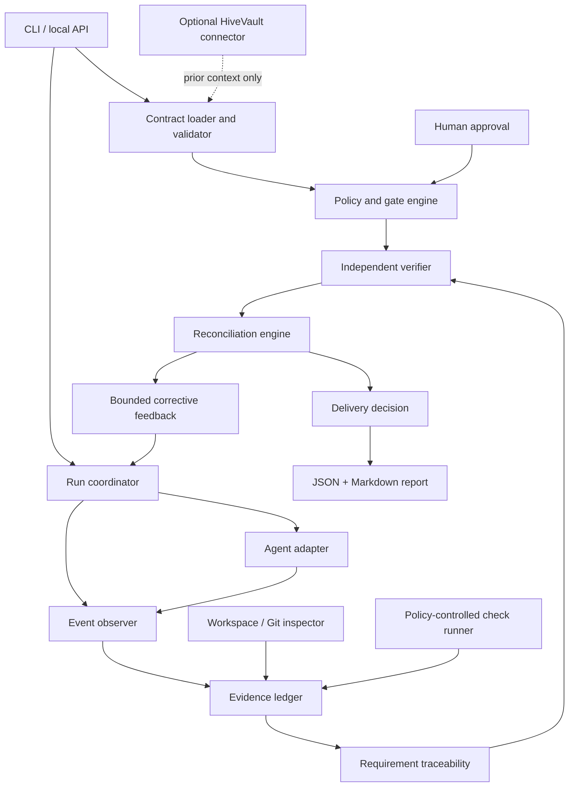

# 04 — Architecture

## Architectural rule

Keep the policy and decision engine independent from the agent adapter. Agent integrations translate events and actions; they must not own the truth of the delivery decision.

## Component view



## Logical modules

1. **Contract** — schema, validation, freeze/version, approved amendments.
2. **Run coordinator** — run lifecycle, state transitions, timeout and retry budgets.
3. **Adapters** — vendor-specific lifecycle event and action translation.
4. **Observer** — normalized event stream and workspace/revision observations.
5. **Evidence ledger** — append-oriented records, references, hashes, redaction metadata.
6. **Check runner** — allowlisted commands, controlled environment, captured outputs and exit status.
7. **Traceability engine** — requirement-to-change-to-test/evidence graph.
8. **Verifier** — requirement coverage, freshness, regression challenges, claim checks, policy checks.
9. **Reconciler** — compares contract, actual diff, check outcomes, exceptions, and agent delivery claims.
10. **Gate engine** — deterministic terminal status and policy enforcement.
11. **Reporter** — portable Markdown and JSON output.
12. **Optional context connector** — retrieves prior decisions from HiveVault without elevating them to current-run proof.

## Dependency direction

`adapters -> normalized events -> ledger -> verifier -> reconciler -> gate/report`

The verifier must not depend on a particular agent SDK. The gate engine must not depend on network access, model calls, or HiveVault. Model-assisted review may be an optional signal, but it must be labelled as such and cannot override hard evidence rules.

## Proposed storage

MVP: local run directory with versioned JSON records and report artifacts; a small embedded database may be considered only if evidence querying proves awkward. Avoid committing secrets or large raw outputs by default. Large outputs may be stored as bounded artifacts referenced by digest and path.

Suggested local layout:

```text
.proofline/
  config.yaml
  contracts/
  runs/
    <run-id>/
      run.json
      events.jsonl
      evidence/
      findings.json
      report.json
      report.md
```

## Architectural constraints

- Evidence is append-oriented; corrections supersede earlier records.
- Every decision records verifier/policy/schema versions.
- Any model-generated finding is distinguishable from deterministic checks.
- A policy change during a run is versioned and must not silently rewrite the earlier decision.
- The final report names the workspace revision it describes.
