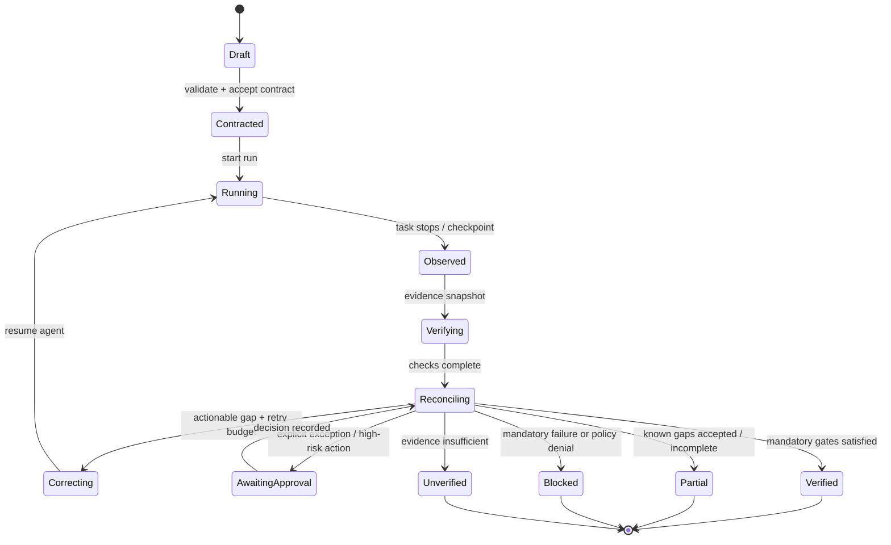

# 05 — Task lifecycle and state machine

## Lifecycle

## State transition rules

- A contract must be validated before a run can enter `Running`.
- A run is bound to a contract version and initial workspace revision.
- Verification uses a defined evidence snapshot; new changes invalidate evidence where relevant.
- Any material change after verification triggers re-verification of affected gates.
- `Verified` is reachable only when all mandatory gates pass with fresh evidence.
- A waived requirement remains visible as waived and normally results in `Partial`, unless the contract explicitly defines it as non-mandatory before the run.
- A policy denial cannot be converted to a pass by agent retry.
- Retry exhaustion moves the run to `Blocked` or `Unverified` with a specific reason.
- Human approval is scoped to a specific action or exception; it does not grant blanket future approval.

## Suggested bounded retry defaults

Defaults must be configurable and validated through the pilot; initial design proposal:
- Maximum corrective cycles per run: 3.
- Maximum repeat of the same normalized finding without meaningful evidence change: 1.
- Every retry must identify which finding it attempts to resolve.
- A retry does not erase prior failures; it appends new evidence and re-evaluates affected gates.

These are starting defaults, not validated performance claims.
