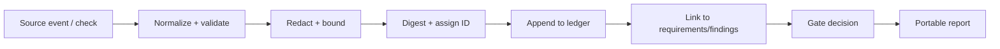

# 07 — Evidence model

## Evidence record fields

The exact schema will be versioned in implementation. Every record should support the following fields:

| Field | Purpose |
|---|---|
| `schema_version` | Parse/migration contract |
| `evidence_id` | Stable unique identifier |
| `run_id` | Run that produced or collected it |
| `kind` | `command`, `test`, `diff`, `agent_claim`, `review`, `approval`, `environment`, `observation`, etc. |
| `source` | Adapter, runner, repository inspector, human, or verifier |
| `created_at` | Timestamp with timezone |
| `requirement_ids` | Related requirements where known |
| `revision` | Commit/tree/workspace identifier, where applicable |
| `environment` | Relevant runtime/tool versions and configuration fingerprint |
| `result` | `passed`, `failed`, `skipped`, `not_run`, `inconclusive`, `stale`, or `waived` |
| `command` | Structured argv, working directory, and policy ID for executed checks |
| `exit_code` | Process result where applicable |
| `output_ref` | Reference to bounded/sanitized output artifact |
| `digest` | Content digest for integrity and deduplication |
| `redactions` | Fields/content omitted or redacted and reason |
| `supersedes` | Prior record IDs replaced by a corrected observation |
| `notes` | Short explanation, not a substitute for structured fields |

## Command evidence

A `command` criterion records one evidence object per run. A run that failed is re-run (`defaults.flaky_reruns`), and the evidence then holds both runs as `first` and `rerun`, so a flaky result shows which tests failed on the first run and passed on the re-run.

| Field | Purpose |
|---|---|
| `cmd`, `exit`, `ms`, `timedOut` | The command as run, its exit code, its duration and whether it hit `timeout_s` |
| `counts` | `tests`, `pass`, `fail`, `skipped`, `todo` and `cancelled` from node's summary (`# fail 3` or `ℹ fail 3`) |
| `out_tail` | The last 1,200 characters of stdout and stderr |
| `failing` | The names of the failed tests found anywhere in the output, not only in `out_tail`: TAP `not ok <n> - <name>` lines, spec and dot reporter `✖ <name> (<ms>ms)` lines, and the `failing tests:` summary node prints at the end. Tests marked TODO or SKIP (in the spec reporter, a `# <reason>` after the duration) are left out. Repeats are dropped, the order is that of first appearance, and the list holds at most 100 names. Output in another format gives an empty list; `out_tail` still holds its end |
| `failing_total` | Present only when more than 100 names were found: how many there were |

The FAIL detail names the first 10 failing tests (`9 tests failed: a, b, c`, then `and <n> more` past 10), and the gate report lists every recorded name under **Failing tests**, per run.

## Evidence rules

- Capture the exact revision against which each check ran.
- A check run before a relevant change is stale for the changed behaviour unless freshness policy proves otherwise.
- With `defaults.reuse_results` on, a `command` or `metric` PASS is recorded as a `result` entry, and a later verify or gate on the same HEAD with a clean tree may reuse it (key: verifier, HEAD, node version, the env vars the command names) for up to `reuse_max_age_h` hours. The reused result is read from that entry, only while it is in an intact chain with the hash the cache file stored, and the report names it: `reused from <time> (evidence entry <n>)`.
- Preserve failed results after a later retry passes; final state may improve but history must not be rewritten.
- Bound output size and execution time.
- Redact secrets before persistence; do not assume command output is safe.
- Record why a check was skipped or could not run.
- Separate raw source evidence from verifier interpretation.
- A hash protects integrity, not semantic validity.
- Evidence may be exported without including full source code or secrets.

## Evidence lifecycle

## Report portability

The report must contain sufficient metadata to interpret the decision after the local process exits: contract version, run ID, revision, policy/verifier versions, requirement status, check status, exceptions, findings, and artifact references. Any omitted raw data must be clearly marked as omitted/redacted and not silently treated as inspected.
