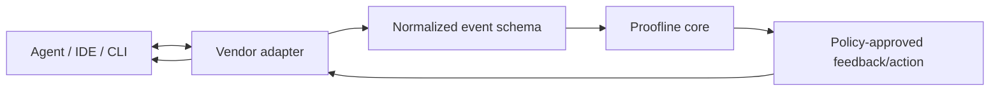

# 08 — Agent adapters

## Purpose

Adapters translate tool-specific lifecycle signals into a stable event model. They do not make final verification decisions and must not have authority to weaken the contract.

## Adapter boundary

## Initial adapter selection

The first adapter should be chosen by a short technical spike using:
- quality of lifecycle signals (start, tool use, stop/completion);
- ability to capture the changed revision and command results;
- stability and documented extension points;
- safe failure behaviour when the agent or hook crashes;
- ease of local installation and reproducible integration tests.

Claude Code and Codex are candidate first adapters because they are part of the target workflow, but the choice must be recorded after testing rather than assumed in advance. Do not implement many thin adapters before one end-to-end path is trustworthy.

## Normalized event categories

- `run_started`
- `agent_message` (claim, not proof)
- `tool_invocation_requested`
- `tool_invocation_completed`
- `workspace_changed`
- `check_requested`
- `check_completed`
- `agent_paused`
- `agent_completed`
- `approval_requested`
- `approval_granted`
- `approval_denied`
- `adapter_error`

Each event includes schema version, event ID, run ID, source adapter/version, timestamp, and any relevant revision or correlation ID.

## Adapter requirements

- Validate and normalize all incoming data.
- Treat tool arguments and agent text as untrusted.
- Do not leak secrets in logs or feedback.
- Preserve ordering/correlation where the host supports it; otherwise report the limitation.
- Fail closed for enforcement-critical events when the adapter cannot establish a required fact.
- Never mark a gate verified merely because the host emitted a completion event.
- Support `observe` mode without taking control of the agent.
- Document host-specific gaps and version compatibility.

## Hook versus core

Hooks are an integration mechanism, not the product differentiator. The durable value is the contract, evidence model, independent checks, reconciliation logic, and enforceable delivery semantics behind those hooks.
