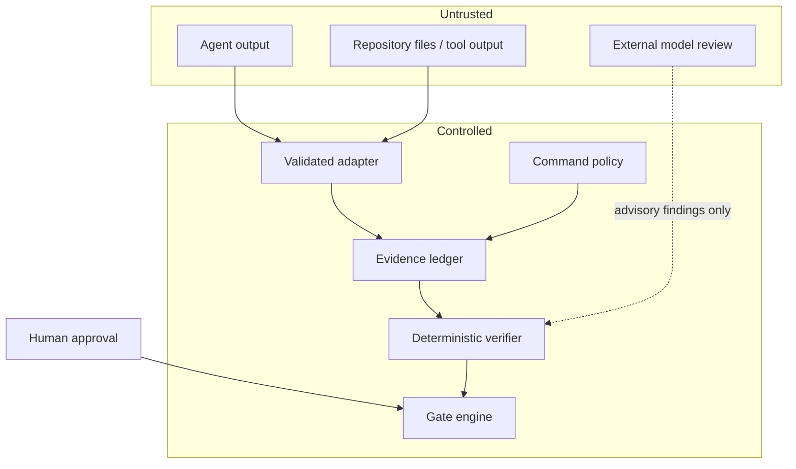

# 09 — Security and trust boundaries

## Threat model

Assets:
- source code and working-tree state;
- credentials, environment variables, and private tool output;
- task contracts, evidence, findings, and approvals;
- integrity of the delivery decision;
- ability to execute commands or modify external systems.

Threat actors and failure sources:
- malicious or compromised agent output;
- prompt injection embedded in repository files, issue text, tool output, or dependency docs;
- unsafe project scripts or malicious test commands;
- compromised adapter or model provider;
- accidental secret capture;
- confused-deputy behaviour where an agent tricks the verifier into using broader permissions;
- false confidence from stale tests, mocked checks, or weak acceptance criteria.

## Trust boundaries

## Required controls for MVP

- Explicit command allowlist/policy; no arbitrary command execution by default.
- Command argv should be structured; avoid shell interpolation where possible.
- Working-directory containment and path traversal protections.
- Process timeouts, output-size limits, and environment filtering.
- Secret redaction before evidence persistence.
- Read-only observe mode as the safest starting point.
- Separate permission for applying corrective edits versus reporting findings.
- Explicit approval for destructive or external side effects.
- Adapter event schema validation and compatibility checks.
- Report that identifies policy and verifier versions.
- No default telemetry or background upload.
- Audit trail for policy changes, exceptions, and approvals.

## Security non-goals

A local verifier cannot guarantee that arbitrary code is harmless, that every malicious change will be detected, or that a model reviewer is free from manipulation. The system reduces specific classes of process failure and makes evidence and residual uncertainty visible; it is not a formal proof of software safety.
