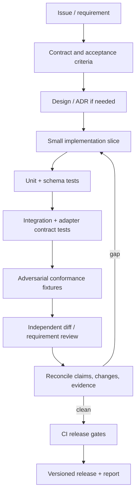

# 11 — Development and release pipeline

## Development loop

## Branch and review policy

- `main` should represent a coherent, CI-checked baseline.
- Use short-lived feature branches and pull requests.
- Each PR names requirement IDs and updates tests/docs/changelog as appropriate.
- Do not merge a change that weakens a mandatory gate without an ADR and explicit rationale.
- Require at least one review for changes to command execution, evidence integrity, gate logic, permissions, or schema migrations.
- Protect `main` with required CI and review rules once repository settings are available.

## CI stages

1. Checkout with minimal permissions.
2. Static formatting and lint.
3. Type/schema checks.
4. Unit tests.
5. Integration tests using synthetic/local fixtures.
6. Adapter contract tests.
7. Adversarial conformance suite.
8. Security and dependency checks.
9. Build/package.
10. Generate provenance/checksum and release report.

The workflow in `.github/workflows/proofline.yml` runs the self-gate (`node bin/proofline.mjs gate --ci`) on every push to `main` and on pull requests, with the branch tip before the push as the base, and uploads the evidence report. Documentation CI must not be misrepresented as software verification.

## Release discipline

- Version schemas independently or document compatibility in the package versioning policy.
- Record commit, build inputs, test results, and artifact digests.
- Publish release notes with added behaviour, limitations, migration notes, and known issues.
- Never publish a release based only on the agent's assertion that it is ready.
- Keep a release checklist and a rollback/recovery plan.
