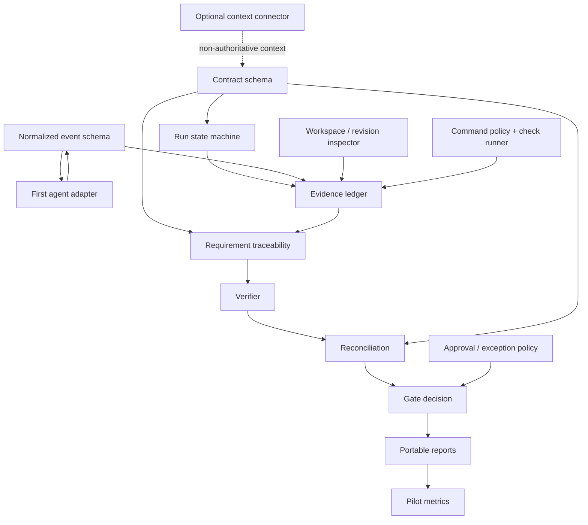

# 13 — Interdependencies

## Dependency map

## Dependency register

| ID | Dependency | Needed by | Risk if delayed | Mitigation |
|---|---|---|---|---|
| DEP-01 | Contract schema and stable requirement IDs | State machine, traceability, reports | Requirements become untestable prose | Define schema and examples first |
| DEP-02 | Adapter lifecycle capability | Observer, end-to-end workflow | Cannot reliably correlate task to events | Spike adapter early; document unsupported signals |
| DEP-03 | Workspace/revision identity | Evidence freshness, diff review | Stale evidence may appear current | Make revision identity mandatory where available |
| DEP-04 | Safe command runner | Independent checks | Arbitrary execution risk | Allowlist, structured argv, timeouts, isolated environment |
| DEP-05 | Evidence record model | All verification and reporting | Lost provenance and non-reproducible decisions | Version schema before multiple consumers |
| DEP-06 | Deterministic gate rules | Enforce mode | False pass or inconsistent status | Implement and test gate logic before hooks can block |
| DEP-07 | Conformance fixtures | Verifier confidence | Regressions in safety semantics | Build adversarial fixtures alongside core |
| DEP-08 | Pilot instrumentation | Product go/no-go | No evidence product helps users | Capture catches, false blocks, latency, interruptions |
| DEP-09 | An optional context connector, for example a project-memory store such as HiveVault | Cross-run context only | Integration may couple core to memory | Keep adapter boundary optional and read-only initially |

## Critical path

`contract schema -> evidence schema -> deterministic gate engine -> synthetic conformance suite -> first adapter -> pilot -> enforce mode`

The first adapter spike can run in parallel with schema work, but it must not force vendor-specific concepts into the core model.

## Integration rule for context connectors

A context connector may store or retrieve prior decisions, project constraints, known failure patterns, and accepted exceptions. Proofline must:
- mark imported context as historical context;
- show source and timestamp;
- ask for confirmation when a historical decision conflicts with the current contract;
- never treat a memory entry as current-run test evidence;
- work with the connector absent.
