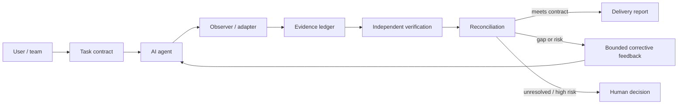

# proofline

[](docs/00-index.md) [](LICENSE)

> **Planning baseline.** Proofline is an independent verification and delivery gate for AI-agent work. The repository currently defines the product contract, architecture, requirements, development plan, and conformance strategy. The executable MVP is not yet implemented.

**Define the work. Observe the work. Verify the evidence. Reconcile the result. Authorize delivery.**

AI coding agents can produce plausible output while missing requirements, expanding scope, skipping checks, or claiming completion without evidence. Proofline is intended to sit outside the implementing agent's own judgement and independently decide what has—and has not—been demonstrated.

## The idea



## What it is

- A task contract with explicit acceptance criteria, exclusions, constraints, and required checks.
- An observer that records relevant agent actions and repository changes.
- An evidence ledger that records what was actually run, against which revision and environment, with what result.
- An independent verifier that challenges coverage, tests, claims, and scope drift.
- A reconciler that compares requested, implemented, tested, and reported work.
- A delivery gate that distinguishes **verified**, **partial**, **blocked**, and **unverified** outcomes.
- A portable report that can be reviewed without trusting the agent that performed the work.

## What it is not

- Not a promise that every kind of work can be automatically proven correct.
- Not a replacement for domain experts, security review, or human approval of high-impact actions.
- Not merely a prompt, a generic agent wrapper, or a stop-hook.
- Not dependent on HiveVault, Claude Code, Codex, or any single model/vendor.
- Not allowed to convert a skipped check into a pass or a claim into evidence.

## Initial operating modes

| Mode | Behaviour | Intended use |
|---|---|---|
| `observe` | Record events and flag likely gaps without interrupting work | Safe introduction and baseline measurement |
| `guide` | Return specific corrective actions with bounded retries | Default development mode after calibration |
| `enforce` | Block delivery on unmet mandatory gates; require approval for controlled actions | CI, release, and higher-assurance workflows |

## MVP boundary

The first deliverable is a local CLI and one deeply supported agent adapter. It will define a task contract, observe a bounded task, run configured checks, reconcile the results, and emit a machine-readable evidence report plus a human-readable summary. The first version should avoid a dashboard, agent swarm, remote control plane, or mandatory HiveVault integration.

See [the documentation index](docs/00-index.md), [scope](docs/01-scope.md), [requirements](docs/02-requirements.md), [architecture](docs/04-architecture.md), and [roadmap](docs/12-roadmap.md).

## Proposed CLI

```bash
proofline init
proofline start --contract task.yaml
proofline watch
proofline verify
proofline report
```

These commands are **proposed interface names**, not implemented commands.

## Status

This repository is a planning and specification baseline. No runtime capability should be considered implemented until its code, tests, evidence, and release status are recorded. Requirements and roadmap items are tracked in [the requirements matrix](docs/02-requirements.md) and [the roadmap](docs/12-roadmap.md).

## Principles

1. **Evidence over assertion.** Agent narration is a claim to check, not proof.
2. **Independent criteria.** The acceptance contract must not be silently rewritten by the implementing agent.
3. **Traceability.** Every requirement maps to implementation evidence, verification evidence, or an explicit unresolved gap.
4. **Honest status.** `not_run`, `skipped`, `failed`, and `passed` are different states.
5. **Bounded correction.** Feedback must be actionable; retries must be limited and loops detected.
6. **Human control.** Irreversible or high-impact actions require an explicit policy and, where configured, human authorization.
7. **Portable evidence.** Reports must remain inspectable and useful without a hosted service or HiveVault.
8. **Fail clearly, not theatrically.** A block must name the unmet gate, supporting evidence, and next action.
9. **Least privilege.** Observation and verification should not grant broader write or execution rights than needed.
10. **No false universality.** Verification rules are task- and domain-specific.

## Licence

Apache-2.0. See [LICENSE](LICENSE). The license is included as a project baseline and should be reviewed before any public release.
